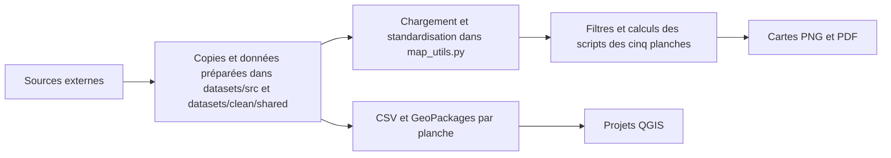

# Catalogue des fichiers de données

Ce catalogue décrit les fichiers présents dans le dossier de production. Les clés permettent de relier des enregistrements. Une clé commune ne prouve pas que deux valeurs ont le même champ ou la même période.

## Chaîne de préparation observée

La planche 01 lit également l'instantané `../web/public/data/rail-network.json`, produit par `export-network.py` pour le site. La chaîne de fabrication initiale des fichiers de `../datasets/src/` et des CSV n'est pas présente en entier. Les flèches vers ces fichiers indiquent leur dépendance aux données, pas une génération vérifiée. Les scripts de planche produisent des cartes. Ils ne documentent pas à eux seuls la création de tous les CSV et GeoPackages.

Au chargement, [map_utils.py](../scripts/map_utils.py) convertit les couches géographiques en EPSG:2154, extrait l'année des dates, nettoie les noms de gares et applique les noms communaux associés aux codes. Les scripts filtrent et agrègent ensuite les données selon chaque planche. Les étapes antérieures de téléchargement, de jointure et de traitement des valeurs manquantes restent à documenter.

## Entrées dans datasets/src et datasets/clean/shared

Les fichiers extraits sont dans [datasets/src](../datasets/src/) ; les fichiers calculés sont dans [datasets/clean/shared](../datasets/clean/shared/). Certaines extractions ont été filtrées ou transformées. Les références externes indiquent les producteurs cités dans les scripts. La version exacte des extractions locales reste à confirmer.

| Fichier | Contenu, période et clé | Utilisation et limites | Source externe |
|---|---|---|---|
| [hackathon_emploi.gpkg](../datasets/clean/shared/hackathon_emploi.gpkg) | Couche `emploi_communes`, 1 276 communes. Clé `code`. Champs `emploi_2015`, `emploi_2025`, `evol_abs`, `evol_pct` et géométrie. | Emploi salarié privé par commune et fond de carte. Le GeoPackage ne contient pas de champ d'emploi 2020. Sa construction initiale n'est pas documentée. | [Urssaf, effectifs privés par commune](https://open.urssaf.fr/explore/dataset/etablissements-et-effectifs-salaries-au-niveau-commune-x-ape-last/). Contours attribués par la documentation à Admin Express COG 2018 via France GeoJSON ; extraction initiale non documentée. |
| [series_emploi_urssaf.json](../datasets/clean/shared/series_emploi_urssaf.json) | Années 2015 à 2025 et valeurs par groupe, dont `IDF`, `Paris` et les groupes de lignes. Clé : nom du groupe et position correspondant à l'année dans `annees`. | Série annuelle pour comparer les groupes. Ce fichier n'est pas une série communale. | [Urssaf, effectifs privés par commune](https://open.urssaf.fr/explore/dataset/etablissements-et-effectifs-salaries-au-niveau-commune-x-ape-last/). Calcul des groupes à confirmer. |
| [series_defm_dares.json](../datasets/clean/shared/series_defm_dares.json) | Années 2015 à 2025 et inscrits en catégories A, B et C par groupe. Clé : nom du groupe et position dans `annees`. | Le fichier indique que 2015 est incomplet et que les inscriptions automatiques affectent 2025. Il conserve ces années mais les cartes comparent 2016 à 2024. | [Dares, données communales](https://www.data.gouv.fr/datasets/inscrits-a-france-travail-donnees-communales-trimestrielles-brutes). Extraction et agrégation à confirmer. |
| [defm_2016_2024.txt](../datasets/src/defm_2016_2024.txt) | Moyennes du 4e trimestre, arrondies au multiple de cinq ; 362 entrées, chacune au format `code:valeur_2016:valeur_2024`, séparées par des virgules. Clé : code commune. | Jointure dans `04_jobseekers.py`. Les communes absentes restent sans valeur. | Dares, même référence que ci-dessus. |
| [insee_emploi_rp_2017_2023.txt](../datasets/src/insee_emploi_rp_2017_2023.txt) | 437 entrées au format `code:emploi_2017:non_salaries_2017:emploi_2023:non_salaries_2023`. Clé : code commune. | Emploi total au lieu de travail, public compris, et non-salariés. Les 839 autres communes du CSV associé n'ont pas de valeur dans ces champs. Le nombre de salariés publics n'est pas isolé. | Insee, recensement via [API Melodi](https://www.insee.fr/fr/information/1302169?question=comment-utiliser-l-api-melodi). Jeu DS_RP_EMPLOI_LT_PRINC ; requêtes exactes non conservées. |
| [reseau_ferre_idf.geojson](../datasets/src/reseau_ferre_idf.geojson) | 1 676 objets géographiques. Champs utiles : `idrefligc`, `idrefliga`, `res_com`, `mode` et `date_mes`. | Tracés et dates d'ouverture. Une ligne peut avoir plusieurs tronçons ; un identifiant de ligne seul n'identifie donc pas une géométrie unique. | [IDFM, tracés du réseau ferré](https://data.iledefrance-mobilites.fr/explore/dataset/traces-du-reseau-ferre-idf/). |
| [gares_idf.geojson](../datasets/src/gares_idf.geojson) | 1 287 objets géographiques. Champs utiles : `id_ref_zdc`, `idrefligc`, `nom_gares`, `res_com` et `date_mise`. | Gares par ligne et dates d'ouverture. Les identifiants de station et de ligne doivent être vérifiés avant une jointure avec un autre jeu. | [IDFM, gares par ligne](https://data.iledefrance-mobilites.fr/explore/dataset/emplacement-des-gares-idf/). |
| [groupes_lignes.json](../datasets/clean/shared/groupes_lignes.json) | Pour chaque groupe, nom de ligne, année `an`, codes et noms des communes. Clé : libellé du groupe, par exemple `M11 (2024)`. | Associe les groupes de lignes aux communes. Un code commune peut appartenir à plusieurs groupes. Croisement des gares et des communes avec Python ; script initial non conservé. | Fichier préparé localement. |
| [noms_officiels.json](../datasets/src/noms_officiels.json) | Dictionnaire code commune vers nom. Clé : code commune. | Remplacement et nettoyage des noms dans `map_utils.py`. Liste Etalab du découpage administratif ; millésime à confirmer. | Etalab, découpage administratif. |
| [dep_idf.geojson](../datasets/src/dep_idf.geojson) | Huit départements, champs `code`, `nom` et géométrie. Clé : code département. | Fond de carte : Admin Express COG 2018. | IGN ou Insee cités dans la planche 01. |
| [rivieres_idf.geojson](../datasets/src/rivieres_idf.geojson) | Trois objets géographiques, avec champ `name`. | Fond de carte. Le nom n'est pas une clé vérifiée pour une jointure externe. | Producteur et millésime non documentés. |

Les codes géographiques doivent rester du texte, notamment pour préserver les zéros initiaux. Les valeurs vides ne sont pas des zéros. Les fichiers texte utilisent des virgules entre les entrées et des deux-points entre les champs.

## CSV préparés par planche

Les CSV utilisent le point-virgule comme séparateur. Les valeurs décimales visibles utilisent une virgule.

| Fichier | Champs et clé | Années et usage |
|---|---|---|
| [gares_2015_2025.csv](../datasets/clean/01_network/gares_2015_2025.csv) | Nom, ligne, mode, date, année et coordonnées Lambert 93. Les identifiants IDFM ne sont pas présents. | Gares retenues pour 2015 à 2025. Le nom seul ne garantit pas une jointure fiable. |
| [ouvertures_par_ligne.csv](../datasets/clean/01_network/ouvertures_par_ligne.csv) | `ligne`, `an`, `troncons`. Clé candidate : ligne et année. | Nombre de tronçons par ligne et année d'ouverture. |
| [emploi_par_commune_2015_2025.csv](../datasets/clean/02_employment_growth/emploi_par_commune_2015_2025.csv) | `code`, `nom`, emplois en 2015 et 2025, variations et `desservie_par`. Clé : `code`. | Comparaison communale du secteur privé. Pas de colonne 2020. Le champ de variation en pourcentage est vide pour 677 lignes. |
| [demandeurs_par_commune_2016_2024.csv](../datasets/clean/04_jobseekers/demandeurs_par_commune_2016_2024.csv) | `code`, `nom`, effectifs en 2016 et 2024, variation et `desservie_par`. Clé : `code`. | 1 276 communes ; les deux champs d'effectifs sont vides pour 914 lignes. |
| [series_demandeurs_par_groupe.csv](../datasets/clean/04_jobseekers/series_demandeurs_par_groupe.csv) | `annee`, colonnes régionales et groupes de lignes. Clé : année et nom de colonne. | Séries 2015 à 2025. Voir les réserves sur 2015 et 2025 dans le JSON Dares. |
| [longueurs_par_mode_2015_2025.csv](../datasets/clean/05_all_networks_2015_2025/longueurs_par_mode_2015_2025.csv) | `famille`, longueurs et nombres de lignes pour les deux années. Clé : famille de mode. | Comparaison 2015 et 2025. Les tronçons partagés peuvent être comptés plusieurs fois. |
| [emploi_par_commune_urssaf_insee.csv](../datasets/clean/06_employment_centers_2015_2025/emploi_par_commune_urssaf_insee.csv) | `code`, emploi privé, densité, statut de pôle et emploi total Insee. Clé : `code`. | Urssaf 2015 et 2025. Insee 2017 et 2023 ; 437 communes renseignées. Les deux sources ont des champs différents. |
| [auto_entrepreneurs_par_departement_urssaf.csv](../datasets/clean/06_employment_centers_2015_2025/auto_entrepreneurs_par_departement_urssaf.csv) | `departement` et effectifs administrativement ou économiquement actifs. Clé : département, année et type d'activité. | Données pour 2015 et 2025. Les deux types d'activité ne sont pas interchangeables. |

Les dossiers des planches contiennent aussi des GeoPackages et des projets QGIS. Ce sont des supports de cartographie. Leur construction et leur portabilité n'ont pas été vérifiées.

## Données nécessaires pour les flux

Les données des planches décrivent l'emploi, les demandeurs d'emploi et le réseau. Elles ne contiennent pas de couples domicile-travail. Pour une carte de flux, la source à ajouter est une base Insee avec les clés de commune d'origine, commune de destination et millésime. L'[Insee décrit ses bases de mobilité professionnelle](https://www.insee.fr/fr/information/2383337) et publie un [fichier détaillé pour 2023](https://www.insee.fr/fr/statistiques/9004795). Ce fichier ne représente pas 2025. Les [validations IDFM](https://prim.iledefrance-mobilites.fr/jeux-de-donnees/histo-validations-reseau-ferre) couvrent 2015 à 2025, mais ne donnent pas à elles seules une origine et une destination par trajet.

## Instantanés du site web

Le site utilise trois fichiers JSON dans `web/public/data/`. Les scripts de `scripts/export-network.py`, `scripts/export-jobseekers.py` et `scripts/export-employment-centers.py` les produisent à partir des données de production. Les sources ajoutées pour les deux derniers exports sont dans `datasets/src/jobseekers/` et `datasets/src/employment-centers/`. Les autres données déjà présentes dans `datasets/` sont réutilisées. Le [catalogue des données web](../web/docs/donnees.md) précise leur provenance, les périodes et les droits à vérifier.
